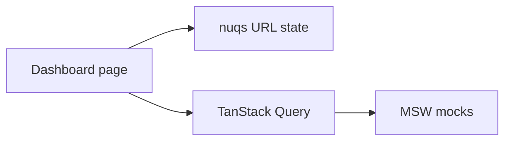

# 02-dashboard architecture

Analytics dashboard with URL-synced date filters, chart widgets, and a virtualized orders table.

## Data flow

1. `useDashboardFilters` reads/writes `from`, `to`, `page`, `pageSize`, `sort` in the URL.
2. Widgets call `fetchOrders` / `fetchMetrics` via TanStack Query keyed on those params.
3. MSW filters seeded orders, aggregates metrics, and returns paginated JSON validated with Zod.

## Deployment modes

- Standalone dev/build on port **5002**
- Module Federation remote `dashboard/App` for `00-mfe-shell`

Vitest runs with federation plugin disabled (see `vite.config.ts`).

Production builds use explicit `react` / `react-dom` resolve aliases so Rolldown can bundle CJS dependents (for example Recharts) alongside Module Federation shared React without `REQUIRE_TLA` errors.
